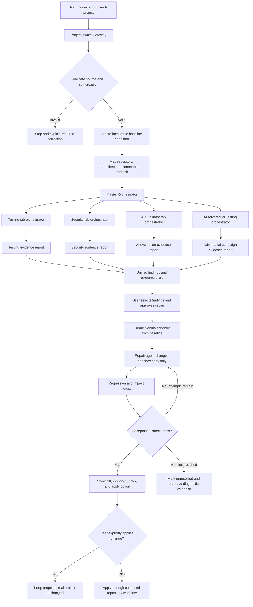
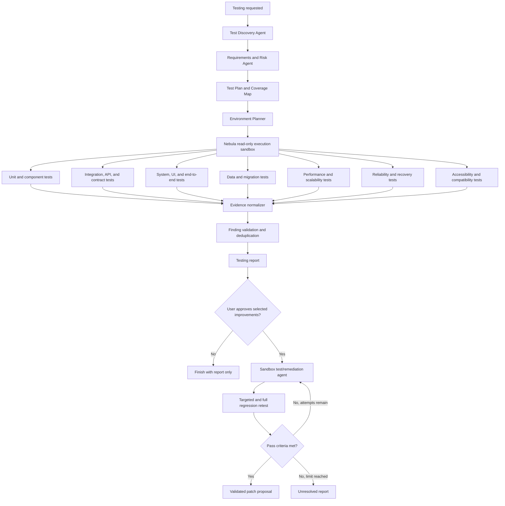
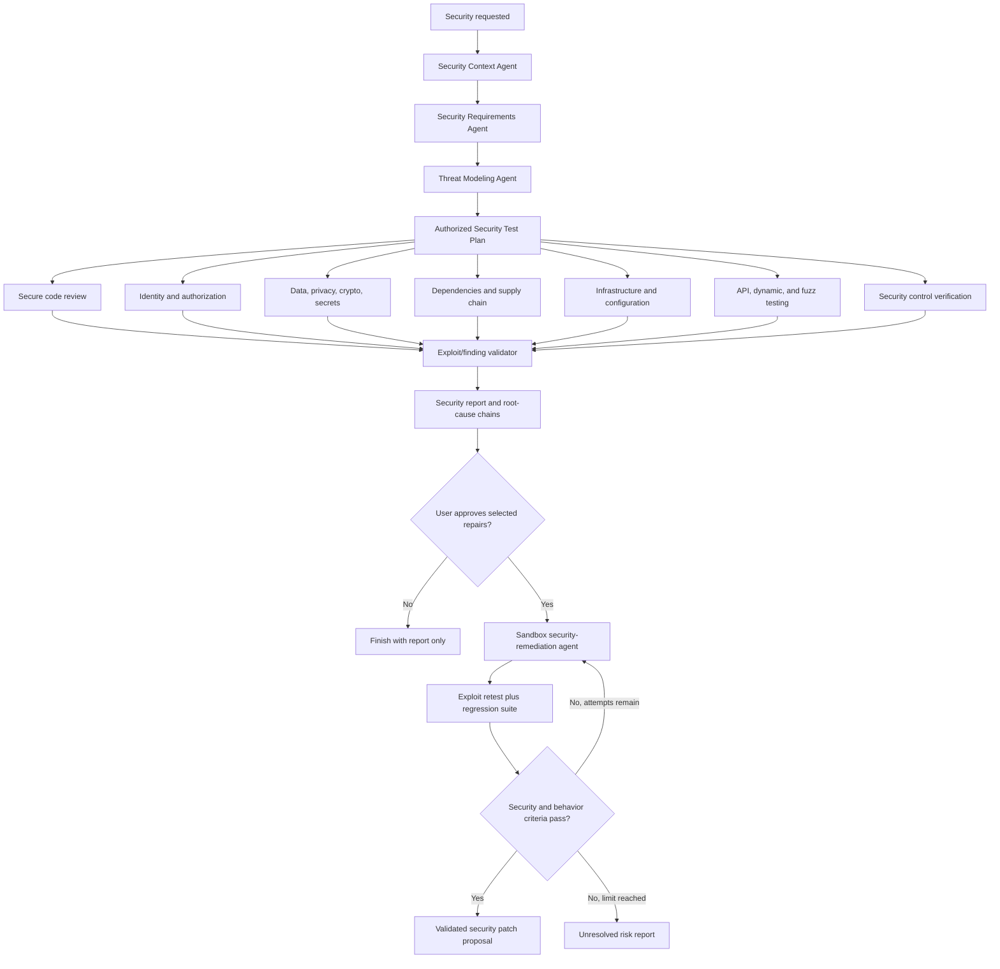
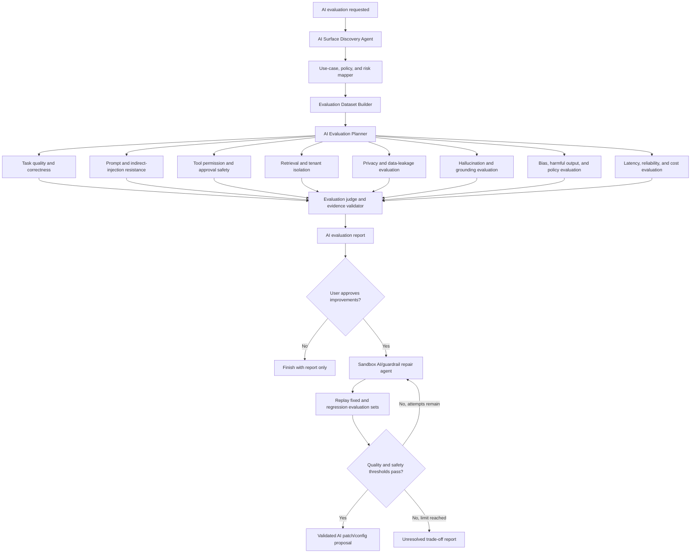
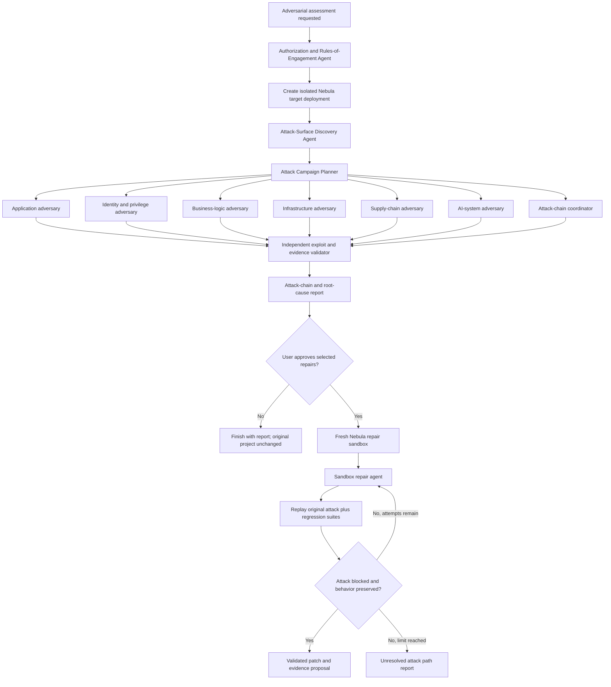
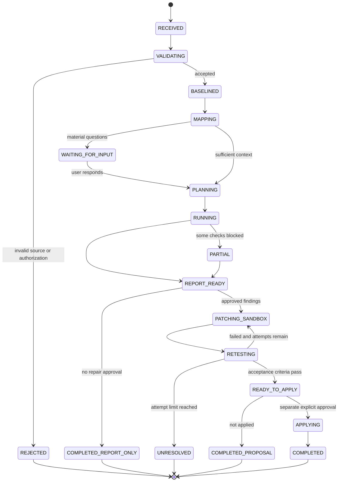

# Full Project Checkup Platform — System Architecture

Implementation companion: [System design and engineering blueprint](./system-design-blueprint.md). That document defines deployment boundaries, persistence, APIs, benchmark targets, failure recovery, and the hackathon implementation scope. Initial evaluation commands execute in isolation as well as repair commands.

## 1. Product concept

The user connects or uploads a software project once. The application presents four independent tabs:

1. **Testing** — correctness, integration, data, UI, performance, reliability, compatibility, and coverage.
2. **Security** — architecture risk, threat modeling, code security, dependencies, configuration, and security-control verification.
3. **AI Evaluator** — AI behavior, prompt injection, tool permissions, retrieval isolation, data leakage, quality, safety, cost, and reliability.
4. **AI Adversarial Testing** — authorized attacker-style campaigns against the complete deployed project, including chained weaknesses across application, infrastructure, business logic, and AI systems.

Every tab follows the same trust model:

> Inspect read-only → plan → run authorized checks → show evidence → request approval → modify only a sandbox copy → retest → present a proposed patch.

The platform never modifies the user's real project merely because it found a problem. Applying an approved, validated patch to the real repository is a separate user-controlled action.

## 2. Top-level journey



## 3. Main system components

### Project Intake Gateway

Accepts a repository URL, uploaded archive, or connected source-control project. It records ownership/authorization, selected revision, project type, exclusions, and allowed commands. It rejects executable instructions embedded in project documents as untrusted project content.

### Baseline Snapshot Service

Creates an immutable reference for the assessment. Every finding, test, and patch points to the same baseline commit or content digest. This prevents reports from silently mixing different code versions.

### Project Intelligence Layer

Builds a shared project dossier:

- languages, frameworks, services, packages, and build tools;
- repository modules and ownership boundaries;
- application entry points, APIs, databases, queues, and third-party services;
- detected build, test, lint, and start commands;
- data flows, trust boundaries, sensitive assets, and AI components;
- missing information and focused questions for the user.

### Master Orchestrator

Owns run state, policy, budgets, agent scheduling, cancellation, retries, evidence, and tab-level progress. It never invents test success: a check is successful only when an executor returns verifiable evidence and an exit/result state.

### Tab Orchestrators

Each tab has a domain-specific planner and specialist agents. A tab can be run alone. All four tabs share the same baseline, project dossier, evidence schema, approval mechanism, and sandbox repair engine.

### Evidence and Findings Store

Stores logs, test results, code locations, screenshots, traces, coverage files, scanner outputs, reproduction records, assumptions, and confidence. Secrets and personal data are redacted before display or model use.

### Approval Service

Freezes the report version shown to the user. Approval is attached to specific finding IDs, proposed objectives, permissions, and risk. A later change of scope requires a new approval.

### Nebula Sandbox Adapter

Creates an isolated copy from the baseline, installs dependencies under policy, applies approved patches, runs tests, and destroys or archives the sandbox according to retention policy. No production credentials are injected.

### Repair and Verification Engine

Applies one small repair batch at a time, runs targeted tests first, then broader regression tests. It uses a bounded attempt limit (default three). Failed attempts remain visible rather than being concealed.

## 4. Testing tab



### Testing report content

- baseline revision and environment;
- commands executed and tools used;
- files, modules, APIs, UI flows, data paths, and services examined;
- test totals: discovered, attempted, passed, failed, skipped, and blocked;
- line/branch/function coverage when measurable;
- requirement and risk coverage rather than only code coverage;
- datasets and synthetic personas/roles used;
- supported browsers, devices, Node/runtime/database versions tested;
- latency, throughput, error-rate, saturation, and resource measurements;
- defects with evidence, confidence, impact, and reproduction information;
- untested areas and reasons;
- proposed improvements and expected benefit;
- explicit limitations—never “everything was tested.”

## 5. Security tab



Dynamic security execution requires an allowlisted target, synthetic test data, rate limits, audit logging, a kill switch, and explicit prohibition on third-party or production targets unless separately authorized.

## 6. AI Evaluator tab

This tab is for projects that contain an LLM, retrieval system, chatbot, autonomous agent, or model-based decision.



An LLM should not judge its own output alone. Important evaluations use deterministic assertions, application telemetry, reference answers, multiple judges where appropriate, and human review for subjective or high-risk decisions.

## 7. AI Adversarial Testing tab

This is a separate authorized red-team function. It does not replace Security. Security assesses whether defensive controls are correctly designed and implemented; AI Adversarial Testing attempts to combine weaknesses and demonstrate realistic end-to-end compromise paths in an isolated deployment.



### Internal adversarial agents

| Agent | Responsibility |
|---|---|
| Authorization and Rules-of-Engagement | Defines exact targets, prohibited systems, techniques, rates, accounts, approval requirements, and stop conditions |
| Attack-Surface Discovery | Maps externally reachable application, API, identity, infrastructure, AI, and integration surfaces |
| Attack Campaign Planner | Produces prioritized, bounded attack hypotheses from assets, exposure, recent changes, and threat intelligence |
| Application Adversary | Exercises sessions, input handling, APIs, files, and application boundaries |
| Identity and Privilege Adversary | Exercises account recovery, authorization, tenant separation, privilege boundaries, and service identities |
| Business-Logic Adversary | Exercises workflow manipulation, replay, race conditions, fraud, and approval bypass |
| Infrastructure Adversary | Exercises exposed services, deployment configuration, cloud permissions, containers, and network boundaries |
| Supply-Chain Adversary | Evaluates build, dependency, artifact, registry, and pipeline trust paths |
| AI-System Adversary | Exercises direct/indirect prompt injection, tool misuse, retrieval isolation, memory poisoning, and data exfiltration controls |
| Attack-Chain Coordinator | Determines whether individually smaller findings can be combined into a material compromise |
| Evidence Validator | Safely reproduces the minimum necessary impact and removes false positives |
| Root-Cause Agent | Connects attacker input to missing control, code/configuration path, demonstrated result, and business impact |
| Attack Replay Agent | Confirms the repair blocks the original attack and has not caused functional, security, or AI regressions |

### Adversarial safety envelope

- written authorization and machine-enforced allowlists;
- isolated production-like Nebula deployment using synthetic data;
- no unrestricted internet targets;
- no production credentials;
- rate, time, compute, and financial budgets;
- minimum-impact proof rather than maximum exploitation;
- immutable action and evidence logs;
- emergency kill switch;
- automatic stop on unexpected real data or scope escape;
- human approval for destructive, denial-of-service, persistence, or third-party testing;
- separate attack, report, repair, and verification phases.

### Adversarial report content

- exact authorized scope and environment fingerprint;
- attack surfaces mapped and surfaces not reached;
- campaigns planned, attempted, blocked, successful, and stopped;
- complete attack chains rather than isolated scanner alerts;
- minimum reproducible evidence with secrets and personal data redacted;
- reason each successful attack worked;
- affected assets, roles, tenants, services, and business operations;
- existing controls that succeeded or failed;
- recommended local fix and systemic prevention;
- attack-replay test required to close the finding;
- explicit assessment limitations—never “the system cannot be hacked.”

## 8. Orchestrator state machine



## 9. Core orchestration variables

### Identity and baseline

| Variable | Purpose |
|---|---|
| `run_id` | Immutable assessment identifier |
| `project_id` | User/project ownership reference |
| `source_type` | Repository, archive, or connector |
| `baseline_revision` | Commit SHA or content digest |
| `requested_tab` | `testing`, `security`, `ai_evaluator`, or `ai_adversarial_testing` |
| `run_status` | Current state-machine value |

### Scope and authority

| Variable | Purpose |
|---|---|
| `authorized_targets` | Exact systems the run may access |
| `prohibited_targets` | Production or third-party targets excluded from testing |
| `allowed_commands` | Commands executors may invoke |
| `network_policy` | Deny, allowlist, or approved dependency-only access |
| `data_policy` | Synthetic/test data and redaction requirements |
| `mutation_allowed` | False during analysis; true only inside approved sandbox repair |
| `approval_id` | Versioned proof of selected user approval |
| `kill_switch` | Immediately terminates active executors |
| `rules_of_engagement` | Versioned adversarial scope, techniques, rates, approvals, and stop conditions |

### Planning

| Variable | Purpose |
|---|---|
| `project_dossier` | Architecture and repository understanding |
| `risk_profile` | Exposure, criticality, data sensitivity, and compliance |
| `test_plan` | Checks, owners, order, and acceptance criteria |
| `agent_graph` | Agents and dependencies selected for this run |
| `task_queue` | Ready, active, blocked, and completed work |
| `budgets` | Time, token, compute, request, and financial limits |

### Execution

| Variable | Purpose |
|---|---|
| `sandbox_id` | Isolated Nebula environment identifier |
| `environment_fingerprint` | Runtime, OS, package, database, and browser versions |
| `attempt_number` | Current bounded repair attempt |
| `maximum_attempts` | Default `3`, adjustable by policy |
| `command_id` | Traceable execution identifier |
| `exit_status` | Success, failure, timeout, cancelled, or blocked |
| `artifact_uris` | Logs, reports, coverage, traces, screenshots, and diffs |

### Findings and decisions

| Variable | Purpose |
|---|---|
| `finding_id` | Stable identifier across report, repair, and retest |
| `finding_status` | Suspected, validated, false-positive, fixed, unresolved, accepted-risk |
| `severity` | Technical and business impact |
| `confidence` | Strength of supporting evidence |
| `evidence_refs` | Reproducible evidence references |
| `selected_for_repair` | User-approved remediation scope |
| `acceptance_criteria` | Exact conditions a repair must satisfy |
| `regression_status` | Targeted and full-suite outcomes |
| `final_verdict` | Report-only, ready-to-apply, partial, unresolved, or blocked |

## 10. Repair loop rules

1. Create a fresh sandbox from the immutable baseline.
2. Reproduce the selected finding before changing code when safe and possible.
3. Apply the smallest coherent repair.
4. Run formatting, linting, compilation/type checking, and targeted tests.
5. Re-run the original failing security/test/AI evaluation.
6. Run related component and integration tests.
7. Run the broader regression suite permitted by time and environment.
8. Compare behavior, performance, security, and AI metrics against baseline.
9. If a regression appears, discard that attempt or produce a revised patch.
10. Stop after the configured attempt limit; never conceal an unresolved result.
11. Present the final diff, evidence, remaining risk, and rollback notes.
12. Require a separate explicit action before applying to the real project.

## 11. User-interface structure

```text
Project: Customer Portal        Baseline: a81f2c7        Overall: 67%

┌────────────────┬────────────────┬────────────────┬──────────────────────┐
│ Testing        │ Security       │ AI Evaluator   │ AI Adversarial Test  │
│ 12 findings    │ 5 findings     │ 8 findings     │ 3 attack chains      │
│ 73% assessed   │ High risk      │ 61% pass rate  │ 18/24 attempts safe  │
└────────────────┴────────────────┴────────────────┴──────────────────────┘

Selected tab
├─ Scope and environment
├─ Architecture/coverage map
├─ What was tested
├─ Results and evidence
├─ Untested or blocked areas
├─ Recommended improvements
├─ Select findings for repair
└─ Approve sandbox repair

Sandbox repair
├─ Attempt 1/3
├─ Proposed changes
├─ Targeted retest
├─ Regression impact
├─ Remaining risk
├─ Download/view patch
└─ Apply to project (separate confirmation)
```

Percentages must always name their denominator. For example, use “73% of 41 planned checks completed,” not an unexplained “73% secure.” Security should not be reduced to a single certainty score.

## 12. Recommended implementation order

### Phase 1 — Useful minimum product

- repository/archive intake;
- immutable baseline;
- project discovery dossier;
- Testing tab with existing test discovery and execution;
- evidence report;
- approval gate;
- Nebula sandbox repair and bounded retest;
- patch/diff output without automatic application.

### Phase 2 — Security

- threat model;
- SAST, secrets, dependencies, and configuration;
- authorization and business-logic review;
- controlled dynamic testing;
- validated security repair/retest loop.

### Phase 3 — AI Evaluator

- AI surface and tool mapping;
- versioned evaluation datasets;
- prompt-injection and data-isolation evaluations;
- quality, grounding, latency, and cost measurements;
- guardrail/config/code repair loop.

### Phase 4 — AI Adversarial Testing

- versioned rules of engagement and target allowlisting;
- isolated production-like Nebula target deployments;
- attack-surface mapping and bounded campaign planning;
- application, identity, business-logic, infrastructure, supply-chain, and AI adversaries;
- attack-chain coordination and independent evidence validation;
- approved sandbox repair, attack replay, and cross-tab regression testing.

### Phase 5 — Enterprise controls

- source-control connectors and proposed pull requests;
- role-based approval;
- policy-as-code;
- signed evidence and audit exports;
- scheduled regression assessments;
- organization dashboards and trend analysis.

## 13. Product trust promises

- Analysis is read-only.
- Changes happen only after the user approves selected findings.
- Repairs happen in an isolated sandbox, never directly in the original project.
- Every claim links to evidence.
- Failed and blocked tests are visible.
- Untested areas are explicitly listed.
- Repair attempts are bounded.
- Applying a validated patch is a separate user decision.
- No report claims that all bugs, vulnerabilities, or AI failures have been eliminated.
- Adversarial testing cannot target production, third parties, or the public internet without separate explicit authorization and policy support.
