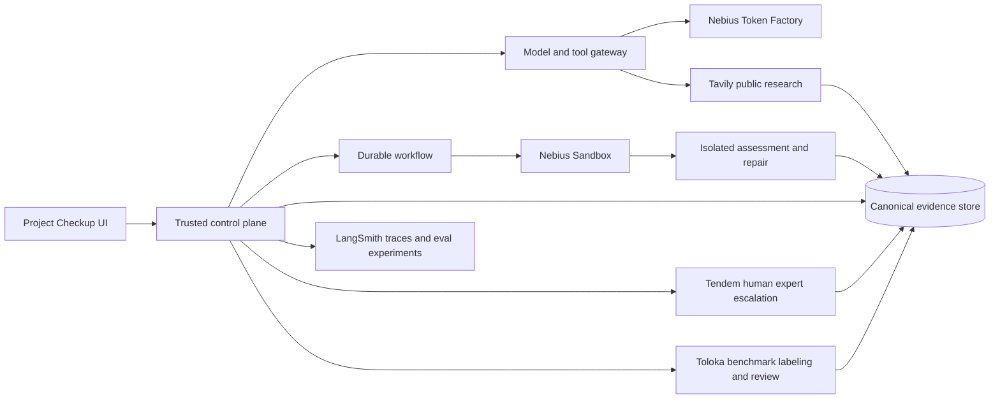
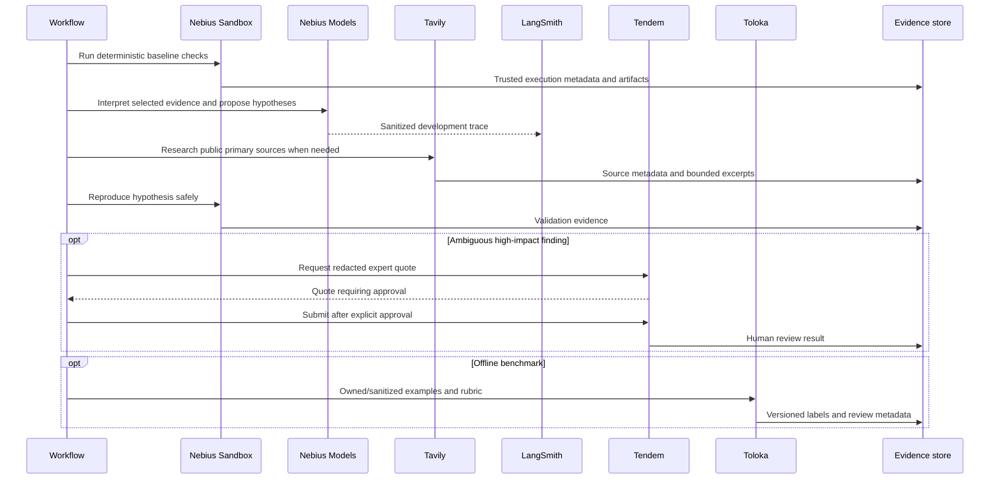

# Hackathon Sponsor Services Integration Plan

Date: 9 October 2026

This plan assigns each available sponsored service one clear responsibility. The supplied links point to authenticated account pages. This document uses public documentation and the user's statement that credits and early access are available; it does not inspect API keys or claim verified balances.

## Service map



| Service | Recommended responsibility | First-demo use | Boundary |
|---|---|---|---|
| Nebius Token Factory | Model inference for mapping, contextual review, explanations and repair proposals | Strong reasoning model plus economical model through one gateway | Cannot create execution evidence or grant permission |
| Nebius Sandbox | Isolated installs, builds, tests, scanners, target deployment, repairs and attack replay | Node.js/TypeScript image; fresh environment per baseline and repair attempt | Must pass isolation, egress, cleanup and artifact contract tests |
| LangSmith | Development tracing, datasets, prompt/model comparisons and offline evaluation | Trace specialist and repair flows; compare prompt/model versions | Internal evidence store remains canonical; private code is redacted/off by default |
| Tavily | Current public documentation, advisories and remediation research | Cited source for one dependency or control finding | Does not scan or attack the submitted target |
| Tendem MCP | Human expert escalation for hard judgment cases | One quoted, approved expert-review path | No automatic spending; use redacted payloads |
| Toloka | Benchmark labels, clean negatives, pairwise judgments and sampled human QA | Review a held-out fixture set supporting measured accuracy | Offline evaluation only; not a production request dependency |

## Nebius Token Factory

Use Token Factory behind a provider-neutral model gateway. Public documentation shows an OpenAI-compatible base URL and asynchronous batch inference, supporting interactive work and cheaper offline evaluation. [Nebius batch API](https://docs.tokenfactory.nebius.com/api-reference/examples/batches), [Nebius batch inference](https://docs.tokenfactory.nebius.com/data-lab/batch-inference).

```typescript
interface ModelProvider {
  complete(request: ModelRequest): Promise<ModelResponse>;
  createBatch?(request: BatchRequest): Promise<BatchHandle>;
  readBatch?(handle: BatchHandle): Promise<BatchStatus>;
  cancelBatch?(handle: BatchHandle): Promise<void>;
  listCapabilities(): Promise<ModelCapability[]>;
}
```

Record provider, model ID, parameters, prompt version, input/output tokens, latency, request ID, policy version and sanitized context references. Apply per-run and per-tenant budgets before dispatch.

Suggested routing:

- economical model: repository summaries, structured extraction, routine classification and report phrasing;
- stronger reasoning model: threat synthesis, ambiguous code paths, attack-chain hypotheses and bounded repair proposals;
- batch inference: offline benchmark runs and prompt/model comparisons.

Fine-tuning is outside the hackathon MVP. First create a reliable frozen evaluation set and compare prompts and models.

## Nebius Sandbox

Submitted projects execute arbitrary installation and test code. Nebius Sandbox therefore protects baseline assessment as well as repairs and adversarial runs.

Implement `NebiusSandboxProvider` only from the early-access API documentation. Validate:

- immutable runtime/image identity;
- CPU, memory, process, disk, time and concurrent-session limits;
- ingress and egress policy controlled outside the guest;
- no access to control-plane credentials, cloud metadata, host filesystem or other tenants;
- snapshot upload and artifact retrieval with digest validation;
- cancellation that terminates child processes;
- stable lifecycle IDs for reconciliation after timeouts;
- TTL cleanup for orphaned environments;
- fresh filesystem, database, queue, cache, account and mock state for each attempt;
- execution logs and environment fingerprints suitable for evidence.

If a required early-access capability is absent, mark the dependent check blocked. For example, a sandbox without controllable egress cannot safely run a general adversarial campaign.

```typescript
interface SandboxProvider {
  create(spec: SandboxSpec, idempotencyKey: string): Promise<SandboxHandle>;
  get(handle: SandboxHandle): Promise<SandboxStatus>;
  uploadSnapshot(handle: SandboxHandle, snapshotRef: string): Promise<void>;
  execute(handle: SandboxHandle, command: CommandSpec): Promise<ExecutionHandle>;
  readExecution(execution: ExecutionHandle): Promise<ExecutionResult>;
  collectArtifacts(handle: SandboxHandle, paths: string[]): Promise<ArtifactManifest>;
  cancelExecution(execution: ExecutionHandle): Promise<void>;
  destroy(handle: SandboxHandle): Promise<void>;
}
```

## LangSmith

LangSmith improves the agents themselves. Its documentation distinguishes offline benchmarking/regression from online monitoring and supports code evaluators, model judges, pairwise comparisons and dataset-level summaries. [LangSmith evaluation types](https://docs.langchain.com/langsmith/evaluation-types).

Recommended projects:

```text
project-checkup-dev
project-checkup-benchmark
project-checkup-demo
```

Trace metadata should include `run_id`, `task_id`, `tab`, `capability`, snapshot digest prefix, prompt version, model and environment. Do not send API keys. Default to sanitized excerpts and evidence IDs rather than whole private repositories or raw logs.

Use code evaluators for schema validity, required citations, expected tool calls, file-location validity and reproducible criteria. Use model judges for subjective properties such as explanation clarity. Product-visible results come from the internal evidence database. A trace does not prove that an external program behaved correctly. [LangSmith online evaluators](https://docs.langchain.com/langsmith/online-evaluations-llm-as-judge).

## Tavily

Use Tavily through a research gateway:

```typescript
interface ResearchProvider {
  search(request: ResearchQuery): Promise<ResearchResult[]>;
  extract(request: ExtractRequest): Promise<ExtractedSource[]>;
}
```

Suitable uses:

- current official guidance for a detected framework/version;
- primary advisories for a package/CVE already identified by deterministic tooling;
- OWASP, NIST, vendor or research context for a finding;
- current mitigations for an attack hypothesis;
- cited explanations in the report.

Tavily documents Search, Extract, Crawl, Map and Research endpoints. [Tavily](https://www.tavily.com/), [Tavily documentation](https://docs.tavily.com/).

Send package names, versions, vulnerability IDs, framework names and generalized queries. Do not send proprietary source, secrets, customer data, private URLs, internal hostnames or unpublished findings. Prefer official domains and store URL, title, retrieval time and content hash.

## Tendem MCP

Tendem offers an AI-plus-human expert workflow through MCP with create, scope, approve and fetch stages. Its official repository documents the hosted endpoint and headless API-key mode. [Tendem MCP](https://github.com/Toloka/tendem-mcp).

```typescript
interface HumanReviewProvider {
  requestQuote(task: RedactedReviewTask): Promise<Quote>;
  approveQuote(quoteId: string, approvalId: string): Promise<HumanTask>;
  getStatus(taskId: string): Promise<HumanTaskStatus>;
  fetchResult(taskId: string): Promise<HumanReviewResult>;
}
```

Suitable escalations include high-severity findings where automated reviewers disagree, business-logic abuse requiring domain judgment, unusual architecture, report-usability review and benchmark-rubric review.

Request a quote first. A user or budget owner approves the price and redacted payload before submission. Public documentation currently names `https://mcp.tendem.ai/mcp`; resolve the correct authenticated endpoint from the user's account during implementation. Keep credentials in a secret manager rather than source or URL parameters when OAuth/header authentication is supported.

## Toloka

Toloka belongs in offline evaluation. Use it to create or review data supporting quality claims:

- classify a finding as true, false or inconclusive from sanitized evidence;
- grade whether file/location and root cause match evidence;
- compare remediation explanations for clarity;
- review AI Evaluator results for correctness, grounding, usefulness and safety;
- create matched safe examples to measure false alarms;
- adjudicate disagreements among model judges.

Toloka supports expert, LLM, combined-review and quorum-style paths with explicit quality criteria. [Toloka quality control](https://platform.toloka.ai/docs/explanation/quality-control/), [Toloka pipelines](https://platform.toloka.ai/docs/explanation/pipelines/).

Create a development set and hidden holdout. Use independent reviewers for ambiguous cases and adjudicate disagreement. Upload owned fixtures or sanitized minimal evidence rather than private repositories.

## Combined information flow



## Credential and data policy

Use separate credentials for development, demo and production. Store them server-side only. Exact names for early-access APIs must follow real documentation.

```text
NEBIUS_API_KEY
NEBIUS_SANDBOX_CREDENTIAL
LANGSMITH_API_KEY
TAVILY_API_KEY
TENDEM_API_KEY or OAuth connection
TOLOKA_API_KEY
```

Never expose them to submitted projects, browser code, patches, screenshots, reports, model context or general logs.

| Data | Nebius model | LangSmith | Tavily | Tendem | Toloka |
|---|---:|---:|---:|---:|---:|
| Owned public fixture code | Allowed | Sanitized trace | Generalized query | Approved excerpt | Approved sample |
| Private source excerpt | Policy-gated minimum | Off by default/redacted | Prohibited | Explicit approval/redaction | Prohibited by default |
| Raw execution logs | Bounded excerpt | Off by default | Prohibited | Approved excerpt | Prohibited |
| Secrets/customer data | Prohibited | Prohibited | Prohibited | Prohibited | Prohibited |
| Package/version/CVE | Allowed | Allowed metadata | Allowed | Allowed | Allowed |
| Benchmark data | Allowed | Allowed experiment data | Usually unnecessary | Approved review | Allowed owned data |

## Credit-aware policy

1. Run deterministic tools in Nebius Sandbox.
2. Use an economical Nebius model for summaries and simple triage.
3. Use a stronger model for ambiguous/high-impact reasoning and patching.
4. Query Tavily only when freshness or external evidence changes the result; cache within policy.
5. Send sanitized traces to LangSmith in development/demo; sample repetitive runs.
6. Use Tendem for a small number of judgment-heavy escalations after quote approval.
7. Spend Toloka credits on benchmark labels and independent evaluation.
8. Use Nebius batch inference for offline prompt/model comparisons.

Track provider, operation, run ID, units, estimated/actual cost, status and value outcome. Configure hard per-run/provider limits and alerts at 50%, 80% and 100% of the configured hackathon allocation. Do not hardcode unverified credit amounts.

## Hackathon demonstration

1. Upload an owned TypeScript demo project.
2. Nebius Sandbox builds it and runs baseline tests and security tools.
3. Nebius Token Factory maps the architecture and interprets selected evidence.
4. Tavily retrieves a current primary source relevant to one finding.
5. LangSmith displays a sanitized trace and offline evaluation result.
6. The user approves one repair; a fresh sandbox applies it and replays the failure plus regressions.
7. The platform presents the verified patch and evidence.
8. Show a small Toloka-reviewed holdout result with numerator and denominator.
9. Optionally show Tendem as the escalation path; disclose prerecorded results if the human task does not finish live.

Optional integrations can fail without corrupting the core journey. Record the missing capability and continue where acceptance criteria permit.
