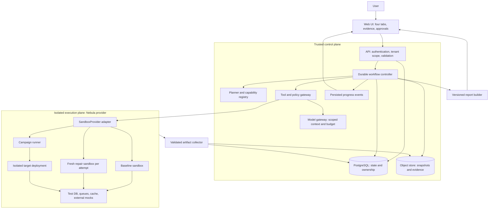
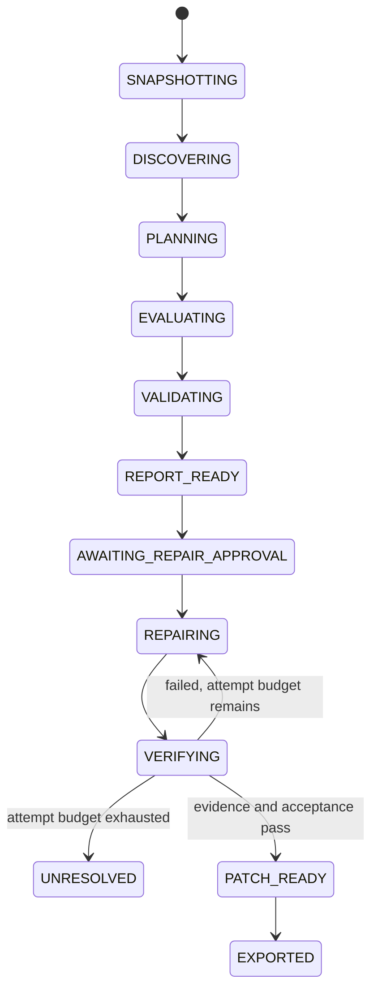
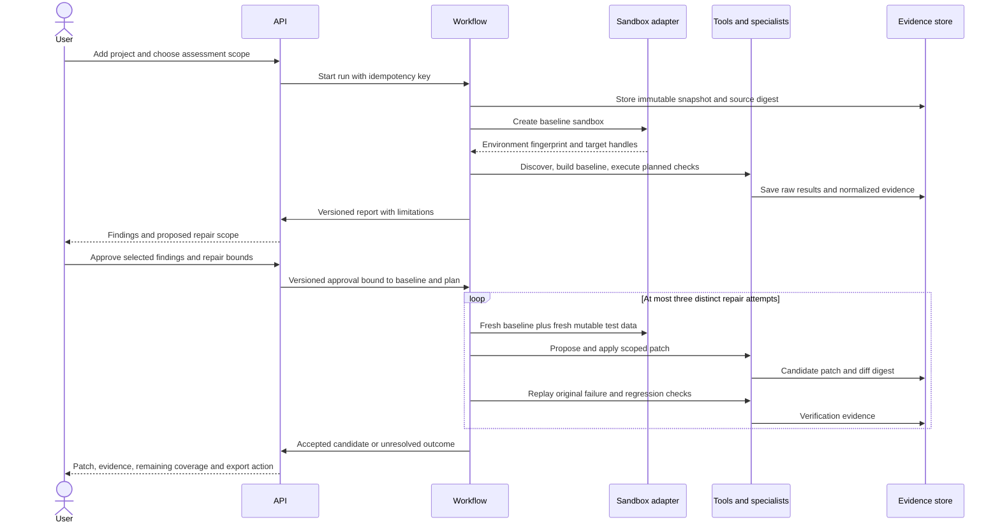
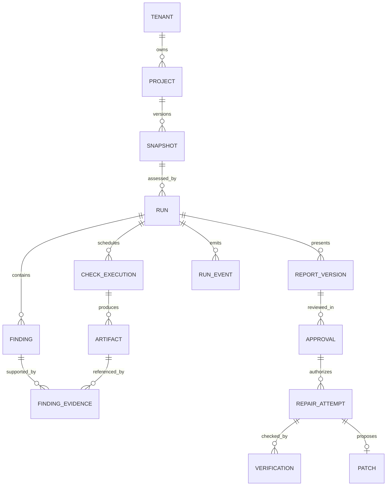

# Project Checkup — Implementation Blueprint

Status: proposed engineering design, 9 October 2026. This document turns the four-tab product architecture into concrete implementation contracts. It is a design, not a claim that the platform or its accuracy has already been tested.

## 1. Recommended approach

Build a **modular application with a durable workflow and a physically isolated execution plane**. The application provides four tabs: Testing, Security, AI Evaluator, and AI Adversarial Testing. Each tab selects a capability plan; they share intake, snapshots, evidence, approval, repair, and reporting.

Use ordinary deterministic code to manage permissions, workflow state, budgets, retries, cancellation, and decisions that require explicit criteria. Invoke AI specialists for repository understanding, contextual review, attack hypotheses, interpretation, and patch proposals. Tool results and independent replay establish evidence.

Four tabs are product boundaries, not four mandatory microservices. Specialist agent names represent prompts, tools, input contracts, and permissions; they do not imply that dozens of models must run on every assessment.

This recommendation follows Microsoft's advice to use the least complex agent pattern that meets requirements, its background-job patterns, and AWS guidance on safe retries. These sources support the principles; they do not prescribe our exact stack. [Microsoft agent patterns](https://learn.microsoft.com/en-us/azure/architecture/ai-ml/guide/ai-agent-design-patterns/), [Microsoft background jobs](https://learn.microsoft.com/en-us/azure/well-architected/design-guides/background-jobs), [AWS safe retries](https://aws.amazon.com/builders-library/making-retries-safe-with-idempotent-APIs/).

## 2. Working assumptions and scope

- First supported stack: Node.js/TypeScript web application or API, with a lockfile, declared build/test commands, and supported version range.
- First intake: upload of a bounded archive or controlled repository snapshot. Provider connectors follow once the core workflow works.
- First demo: owned fixture repository with known defects, clean negative examples, synthetic accounts, and a small AI component.
- AI Evaluator assesses AI behavior inside the submitted project. Projects without AI receive `NOT_APPLICABLE` for that tab.
- Repairs are small code/configuration changes. Major refactoring and dependency-major-version migrations require separate plans.
- The hackathon exports a validated patch. Applying it to a source repository is a later, separately approved operation.
- Nebula is the requested execution provider, but its exact product URL and capabilities are not confirmed. Implement a provider contract; verify its SDK, isolation, network controls, artifact transfer, and lifecycle before integrating.
- Deadline, team size, hosting budget, model budget, and exact provider remain open inputs. These affect delivery scope, not the architecture's trust boundaries.

Non-goals for the first release: universal language support, arbitrary public-site testing, production deployment, unrestricted autonomous attack campaigns, guaranteed vulnerability completeness, and unlimited repair loops.

## 3. System deployment and trust boundaries



The public UI/API stays responsive while long jobs run elsewhere. Submitted install hooks, builds, tests, browsers, scanners, generated commands, and uploaded artifacts are untrusted workloads. They execute inside isolated environments from the first assessment, not only during repair.

Use a new logical test-data namespace for each baseline, campaign, and repair attempt. The diagram's shared mocks label means the same service types, not shared mutable state between attempts or customers.

## 4. Technology decisions and why

| Decision | Initial recommendation | Reason and trade-off |
|---|---|---|
| Language | TypeScript across UI/API/workers/contracts | One language reduces hackathon integration friction; execution adapters can later support other runtimes |
| Web UI | React/Next.js | Suitable for project pages, four tabs, evidence and progress; business workflow lives in the backend |
| API | TypeScript service, e.g. Fastify | Explicit request schemas and separate worker lifecycle; framework choice is replaceable |
| Workflow | Temporal TypeScript SDK, subject to a short setup spike | Persistent long jobs, approval waits, retry/cancel recovery; introduces an operational dependency |
| Simpler fallback | PostgreSQL-backed job/state machine | Acceptable if workflow setup threatens deadline; must implement leases, retries, checkpoints and recovery explicitly |
| Database | PostgreSQL | Transactions for approvals, tenancy, findings and run transitions; relational constraints prevent invalid ownership relationships |
| Artifact storage | Private S3-compatible object store | Logs, source snapshots, traces and coverage can be large; DB keeps metadata and hashes |
| Progress | Server-sent events with event sequence IDs | Browser needs one-way progress updates; reconnect resumes from persisted sequence |
| AI access | Provider-neutral model gateway | Tracks tokens, redacts context, validates structured outputs, applies routing and versioning |
| Sandbox | Nebula adapter | Keeps user preference while avoiding an invented provider API |
| Tool capabilities | Versioned plugins executed in isolation | Check types change independently of UI; schemas normalize diverse scanner/test output |
| Telemetry | OpenTelemetry | Correlates request, workflow, activity, tool execution and model call with traces, metrics and logs |
| Deployment | Web/API, workflow worker, DB, store, sandbox service | Independently scales user traffic and assessment work without creating excessive service boundaries |

Use one workflow mechanism. Do not run Temporal, a second job queue, and a custom state machine as competing authorities. If Temporal is selected, its activity task queues dispatch work; PostgreSQL stores product records and projections. Provider creation/execution belongs in activities, not deterministic workflow replay code. Activities still require idempotency. [Temporal operation semantics](https://docs.temporal.io/nexus/operations).

OpenTelemetry defines traces, metrics, and logs as distinct correlated signals. It helps diagnose a stalled assessment without storing source code in general telemetry. [OpenTelemetry signals](https://opentelemetry.io/docs/concepts/signals/).

## 5. Master orchestrator and agent contracts

The master orchestrator is a stateful controller. Each tab supplies a directed task graph. Nodes become runnable only when dependencies complete and policy permits execution. Nodes that cannot run become blocked or not applicable with reasons.

An AI planner may propose a graph from a bounded capability catalog. Code validates tool names, parameters, permissions, budgets, dependencies and graph size before acceptance. The planner cannot create new authority, approve itself, or mark a tool invocation successful.

Agent input contract:

```typescript
type AgentTask = {
  taskId: string;
  tenantId: string; // supplied by trusted runtime
  runId: string;
  snapshotId: string;
  capability: string;
  objective: string;
  artifactRefs: string[];
  contextRefs: string[];
  policyVersion: string;
  allowedTools: string[];
  acceptanceCriteria: string[];
  budget: { maxInputTokens: number; maxOutputTokens: number; maxToolCalls: number; deadline: string };
};

type AgentResult = {
  taskId: string;
  status: 'completed' | 'blocked' | 'failed' | 'not_applicable';
  claims: Array<{ text: string; evidenceRefs: string[]; confidence: 'low' | 'medium' | 'high' }>;
  proposedFindings: string[];
  proposedActions: string[];
  unresolvedQuestions: string[];
};
```

Validate results against a schema. Evidence references must resolve to the same tenant, run, snapshot, tool execution, and permitted artifact. Confidence is a qualitative assessment; it is not a calibrated probability until benchmarked.

### Workflow states and transactional dispatch



Any active stage can enter `BLOCKED`, `FAILED`, or `CANCELLED`; preserve partial evidence and diagnostics. `NOT_APPLICABLE` belongs to an individual check/tab rather than silently passing the entire run.

When an API transaction creates a run, approval, or cancellation, write a dispatch intent in the same database transaction. An outbox dispatcher sends it to the workflow engine using a stable ID and records acknowledgement. This closes the crash gap between saving a run and starting its workflow. One authority owns execution transitions; product database projections reconcile against workflow history. A PostgreSQL-only fallback needs worker leases, expiry and fencing tokens. Use version checks/cancellation generations to reject late worker writes after cancellation.

### Three review passes

1. **Question and requirements challenge:** is the concern grounded in the project, user requirement, asset, or observed behavior? Reject imagined requirements and record real unknowns.
2. **Mechanism and counterexample review:** propose a fix/control, then look for cases where it fails, changes behavior, or moves risk elsewhere.
3. **Independent evidence review:** inspect source/configuration, reproduce in isolation where possible, and replay acceptance/regression checks. Design-only concerns remain explicitly unverified.

Three identical model answers are not three independent proofs. Use different evidence channels and independent review for serious, ambiguous, or model-only findings. Apply all three review passes to major design decisions; avoid tripling every trivial model invocation.

## 6. End-to-end execution



The loop ends immediately on a verified acceptable candidate. Failed attempts are discarded as deployable candidates but retained as diagnostic evidence. Candidate two uses the unchanged baseline and lessons from candidate one; it does not silently inherit its code or database mutations.

## 7. Capability plans by tab

| Tab | First real implementation | Expansion path |
|---|---|---|
| Testing | Existing build/type/unit/integration suites, bounded API/browser checks, baseline comparison | Test generation, DB migration suites, accessibility, compatibility matrix, load and recovery tests |
| Security | Secret detection, dependency audit, static code rules, contextual authorization review | Threat modeling, control verification, privacy/crypto/IaC analysis and risk triage |
| AI Evaluator | Declared AI endpoint adapter, versioned fixtures, deterministic expected outcomes, latency/cost | Grounding, retrieval isolation, subjective rubric review, robustness and larger datasets |
| AI Adversarial Testing | Owned isolated deployment, synthetic roles, bounded cross-tenant or workflow campaign, evidence and replay | Multi-step application/infrastructure/AI campaigns under versioned rules of engagement |

Examples of suitable initial tools: project-native test runner, TypeScript compiler, Playwright, dependency-audit tooling, secret detector, and static-analysis rule engine. Pin versions after compatibility checks. A tool failure is not a clean security result.

Run fast deterministic checks first. Invoke the right AI specialist only for ambiguous/high-value cases. A clean dependency result requires no dedicated model conversation. AI Evaluator shows not applicable when no AI interface exists. Adversarial testing requires a deployment adapter; unsupported deployments become blocked with useful diagnostics.

## 8. Data model and evidence lineage



Key fields:

- `snapshot`: source revision, content digest, archive URI, manifest, exclusions, intake policy version.
- `run`: tenant/project/snapshot, selected tabs, plan digest, status, budget, timestamps, engine/model/tool versions.
- `check_execution`: capability, invocation digest, environment digest, actual command or tool args, exit code, timeout, status, duration, artifact links.
- `artifact`: tenant/run/check, object key, content hash, type, size, redaction status, retention deadline. Raw restricted evidence and sanitized display evidence are distinct artifacts.
- `finding`: class, stable identity, affected path/location, business severity, confidence, status, evidence links, limitations. A runtime finding may have no source location.
- `approval`: actor, report version, selected finding IDs, baseline digest, repair-plan digest, permitted files/actions, budget, expiry, revocation.
- `repair_attempt`: approved scope, attempt number, sandbox, candidate digest, predecessor lesson references, result.
- `verification`: original-failure replay, baseline regression comparison, environment/test-plan digest, pass/fail/blocked outcomes.
- `patch`: digest, source baseline, changed files, candidate artifact, verification version, application status.
- `run_event`: monotonically increasing sequence per run, event type, timestamp, sanitized payload.

Every query and object-store access checks tenant ownership server-side. Models do not select tenant scope. Use composite ownership constraints and row-level policies where appropriate. Download URLs are short-lived and scoped.

### Why normalize data?

Different tools describe the same problem differently. Keep raw evidence, parse it into a common finding schema, and deduplicate by snapshot, weakness class, affected resource, and independently verified behavior. Do not collapse different attack paths merely because their titles match.

Counts must come from stored executions. Report wording may use AI, but a deterministic report renderer owns numbers, statuses, artifact references and totals. Preserve skipped/blocked/not-applicable distinctions. Every displayed percentage identifies its denominator.

### Trusted verification boundary

A project can print fake JUnit output or a fabricated `all passed` message. Mark workload-produced files as untrusted observations; the external supervisor records execution identity, invocation, exit status, timestamps, image/snapshot digests and artifact hashes. Hashes establish integrity after capture, not truth of the project's assertions.

High-impact findings require independent controlled reproduction. Keep original-failure and independent regression suites outside the candidate patch's mutable source. Reject or review changes that delete tests, suppress assertions, relax security policy, disable scanners or replace a failing command with a no-op. Existing project tests remain useful evidence, but cannot alone prove adversarial safety.

Serialize patches that share a candidate working tree. If Testing and Security produce separate passing changes, verify their combined diff before presenting it as one accepted patch. Attempt isolation covers filesystem, database, queues, cache, synthetic account state and external mocks.

## 9. API surface

| API | Behavior |
|---|---|
| `POST /projects` | Creates owned project metadata |
| `POST /projects/{id}/snapshots` | Accepts bounded upload/revision and produces immutable snapshot |
| `POST /runs` | Validates tabs/scope, requires idempotency key, returns run ID |
| `GET /runs/{id}` | Returns persisted progress and outcomes |
| `GET /runs/{id}/events?after={sequence}` | Resumable SSE progress |
| `GET /runs/{id}/reports/{version}` | Returns immutable report version |
| `GET /findings/{id}/evidence` | Returns authorized sanitized evidence references |
| `POST /runs/{id}/repair-approvals` | Binds selected findings to revision, plan and bounds |
| `POST /runs/{id}/repairs` | Starts approved bounded repair workflow |
| `POST /runs/{id}/cancel` | Requests cancellation and resource cleanup |
| `GET /patches/{id}` | Provides diff plus verification status |
| `POST /patches/{id}/apply-approvals` | Later release: approve exact patch and target revision |

Repeated idempotency key plus unchanged parameters returns the original operation. Reusing a key with changed parameters is rejected. After an ambiguous provider timeout, reconcile existing resource state before creating another sandbox.

## 10. Sandbox contract and provider qualification

```typescript
interface SandboxProvider {
  create(request: SandboxSpec, idempotencyKey: string): Promise<SandboxHandle>;
  get(handle: SandboxHandle): Promise<SandboxStatus>;
  uploadSnapshot(handle: SandboxHandle, snapshotRef: string): Promise<void>;
  execute(handle: SandboxHandle, command: CommandSpec): Promise<ExecutionHandle>;
  readExecution(execution: ExecutionHandle): Promise<ExecutionResult>;
  collectArtifacts(handle: SandboxHandle, paths: string[]): Promise<ArtifactManifest>;
  cancelExecution(execution: ExecutionHandle): Promise<void>;
  destroy(handle: SandboxHandle): Promise<void>;
}
```

`SandboxSpec` includes image digest, source digest, resources, TTL, mount policy, egress policy and test-data namespace. `CommandSpec` includes argv, cwd, timeout, environment allowlist, output limits and execution idempotency key. Avoid assembling arbitrary shell strings where argument-based execution is possible.

Acceptance test the adapter before relying on it: prevent control-plane filesystem access and metadata-service access; enforce egress policy; terminate process trees; isolate tenant and attempt state; recover resource IDs after timeout; export evidence safely; expire orphaned resources; redact credentials; reject provider callbacks that fail authentication.

Archive intake itself is hostile input: limit expanded size and file count, reject traversal and unsafe symlinks, block remote URL fetches that can reach internal services, and ensure extraction paths remain inside the intake workspace. Dependency installation requires controlled registry access; subsequent execution uses the narrower test/campaign network policy.

A product named Nebula was not uniquely identified by research. Provider capabilities are an integration dependency, not assumed facts. No architecture should pretend an unverified SDK exists.

## 11. Approvals and source drift

Repair approval authorizes bounded work against a specific baseline, finding set and plan; it does not authorize applying an unknown future patch to production. Candidate approval, when application is added, binds exact patch digest, target revision, test-plan digest and verification result.

The executor checks authorization at the action boundary. It atomically records/consumes execution authorization with its idempotency record so replay cannot cause duplicate side effects. Multi-action repair scopes produce distinct bounded execution permits; the workflow can resume without treating an already-consumed permit as fresh authority.

If source, target configuration, selected files, repair objectives, or permission scope materially changes, invalidate the relevant approval and verification. A real-project revision change requires rebase plus affected retesting before application.

OWASP explicitly recommends binding approval to the actor and exact tool call, with checks at execution time. [OWASP AI Agent Security](https://cheatsheetseries.owasp.org/cheatsheets/AI_Agent_Security_Cheat_Sheet.html).

## 12. Token efficiency and cost control

1. Parse manifests, lockfiles, routes, symbols and test results with code before calling models.
2. Build one immutable project dossier; reference it rather than repeating discovery for four tabs.
3. Retrieve relevant symbols, dependency neighborhoods and evidence snippets. Include content hashes and locations for traceability.
4. Keep raw logs in object storage. Pass bounded excerpts and structured summaries; allow targeted retrieval when context is insufficient.
5. Cache eligible deterministic outputs by source digest, tool/rule version and relevant configuration. Model caches also include prompt, model, policy and context versions.
6. Isolate cache keys by tenant. Never reuse private-code-derived context across organizations.
7. Route routine extraction and summarization to the least expensive model that passes its benchmark; reserve stronger models for ambiguous reasoning and repair.
8. Use schema/evidence validation before calling a second model. Independent review is mandatory only where risk or ambiguity justifies it.
9. Bound tool calls, model tokens, elapsed time and repair attempts; reserve budget atomically before dispatch to avoid parallel overspend.
10. Measure actual cost per completed run, validated finding and accepted repair. Treat cache-hit savings as measured results, not estimates of achieved quality.

Keep high-value context: authorization paths, changed symbols, affected tests, relevant data flows. Tiny context windows can lower recall. Compare retrieval strategies against a larger-context baseline and inspect missed findings before optimizing further.

A token budget equation is `total model tokens = discovery + selected specialist inputs/outputs + validation + bounded repair/retest interpretation`. Storage references save repeated text but are not evidence unless the model/tool actually retrieves their content.

## 13. Defining the greater-than-90% goal

The design can target measured quality; it cannot promise quality before implementation and evaluation.

| Metric | Definition | Proposed initial acceptance target |
|---|---|---|
| Finding precision | Independently confirmed true findings / all findings displayed as confirmed | Greater than 90% on a named held-out supported-stack set |
| Detection recall | Detected seeded defects / seeded defects present | Report by supported class; target at least 90% for declared narrow classes |
| Evidence correctness | Audited report assertions matching raw executions and references / audited assertions | 100% for mechanically checkable status/count/reference assertions |
| Verified repair success | Accepted repairs passing original failure plus required independent regression / approved repairs attempted | Measure first; target greater than 90% only for a defined narrow repair catalog |
| Regression escape | Accepted repairs failing subsequent independent tests / accepted repairs | Report separately; zero known regressions in the demo |
| Unsupported/abstention rate | Blocked, uncertain or unsupported cases / attempted cases | Always disclose; do not omit to inflate precision |
| Cost and duration | Actual dollars, tokens, tool seconds and end-to-end time per run | Set budgets after a real baseline benchmark |

Create clean negatives, known vulnerable examples, and unseen variations. Split fixtures into development, validation and frozen holdout by project/family, not nearly identical files. Keep ground truth outside agent context. Include deployment failures, absent tests and already-failing baselines.

Report numerator, denominator, per-class performance and confidence intervals. A point estimate above 90% on a small sample is weak evidence. If claiming the population exceeds 90%, require the chosen confidence interval's lower bound to exceed 90% on the declared population. Track model/prompt/tool/environment revisions and rerun after changes.

Use externally maintained benchmarks where applicable, and an owned integration fixture set for whole-project repair and business logic. Never generalize a narrow benchmark to all applications or vulnerability classes. NIST emphasizes contextual measurement, uncertainty and independent assessment. [NIST AI RMF measurement](https://airc.nist.gov/airmf-resources/airmf/5-sec-core/).

## 14. Failure and recovery decisions

| Trigger | Required behavior | Verification |
|---|---|---|
| Worker dies mid-run | Resume from saved workflow state; reconcile unfinished execution | Kill worker during a fixture assessment |
| Sandbox create times out | Query by operation ID; avoid duplicate allocation | Simulate response loss after successful create |
| Tool exits nonzero | Distinguish test failure from scanner crash; keep raw evidence | Fixture with failed test and malformed scanner output |
| Baseline already fails | Preserve failures; compare only reproducible outcomes; block unsupported fix claims | Known failing baseline fixture |
| Flaky test | Bounded repeat and classify unstable; do not silently count pass | Controlled intermittent test |
| User cancels | Stop dispatch, terminate active processes, collect safe evidence and clean resources | Cancel during install/test/attack/repair |
| Budget exhausted | Stop new work, preserve partial report and remaining scope | Concurrency cost reservation test |
| Approval revoked or expires | Check at execution boundary; pause dependent actions | Revoke while queued |
| Candidate introduces regression | Reject candidate; retry fresh state within bound | Hidden independent regression fixture |
| Three repair attempts fail | Return unresolved finding and diagnostic history | Unrepairable fixture |
| Project changes | Invalidate stale comparison/application; reassess changed revision | Source-drift test |
| Repo/log contains instructions | Treat as untrusted data; policy/tool gateway remains authoritative | Injection in README and tool output |
| Tenant mismatch | Deny query/artifact/tool access | Cross-tenant ownership tests |
| Artifact upload lost | Incomplete evidence blocks verified verdict; reconcile or repeat | Simulated storage failure |
| Sandbox remains orphaned | TTL plus reconciler destroys resource; report cleanup failure | Lost-worker resource test |

Infrastructure retries are distinct from repair attempts. Use bounded exponential backoff and jitter for transient failures; never retry validation errors as though they were outages. Stop redundant retries across layers. AWS describes why retrying side effects requires idempotent operation contracts. [AWS retry guidance](https://docs.aws.amazon.com/wellarchitected/latest/reliability-pillar/rel_mitigate_interaction_failure_limit_retries.html).

## 15. Forecasting capacity and scaling

Initial provisional limits: two active sandboxes per project, one active patch writer per candidate, and globally bounded campaign concurrency. Tune from measurements.

If arrival rate is `lambda` runs/minute and average sandbox occupancy is `W` minutes/run, average active demand is approximately `lambda × W`; provision measured headroom rather than treating this average as a peak guarantee. Separate queue wait, model time, build/test time and approval wait. Approval waits should not retain idle sandboxes.

Scale execution workers from queue age, eligible task backlog and provider quota. Limit model calls by provider/token quota. Scale API separately from workers. More workers do not solve DB/object-store/model bottlenecks. Use per-tenant fairness to prevent one large repository starving others. [Microsoft competing consumers](https://learn.microsoft.com/en-us/azure/architecture/patterns/competing-consumers).

Do not claim tests simulate real people: report virtual users, workload mix, dataset size, concurrency, duration and request rate. A small demo load test cannot establish production capacity without representative data and environment.

## 16. Proposed repository layout

```text
apps/
  web/                     # four-tab UI, reports, approval views
  api/                     # auth, tenancy, schemas, run endpoints
  worker/                  # workflows and activity registration
packages/
  contracts/               # typed schemas and shared identifiers
  workflow/                # state transitions and capability graphs
  project-intelligence/    # manifests, routes, symbols, context retrieval
  capabilities/            # testing/security/AI/adversarial plugins
  model-gateway/           # routing, budgets, structured responses
  sandbox-adapters/        # Nebula implementation and contract tests
  evidence/                # normalization, provenance, redaction
  reporting/               # deterministic counts and report rendering
  policy/                  # permissions and execution authorization
  persistence/             # schema, migrations, object-store metadata
fixtures/
  demo-project/            # owned synthetic full-journey demo
  development/             # tuning fixtures
  holdout/                 # frozen evaluation set; ground truth withheld
docs/
  decisions/               # architecture decision records
  operations/              # deploy, recovery, cleanup and monitoring
```

## 17. Implementation milestones and completion criteria

### Milestone 0 — Integration proof

Prove sandbox creation, immutable snapshot upload, install/build/test, artifact retrieval, cancellation and destruction using one owned fixture. Validate workflow restart and one schema-checked model call. Resolve exact Nebula provider before claiming integration.

### Milestone 1 — Complete Testing journey

Project intake → isolated baseline → existing tests → evidence report → selected repair approval → fresh sandbox patch → original failure replay → regression comparison → downloadable diff. Include one deliberate blocked run. This is the highest-value first vertical slice.

### Milestone 2 — Security and adversarial evidence

Add real scanner results and one independently reproduced authorization flaw. Separate Security control review from the AI Adversarial campaign tab. Replay the flaw after repair and validate normal account behavior.

### Milestone 3 — AI Evaluator

Add declared AI endpoint, frozen evaluation fixtures, deterministic quality/safety assertions, injection case, latency and actual cost. Correctly show not applicable for ordinary projects.

### Milestone 4 — Hackathon release

Demonstrate all four tabs using real persisted evidence. Present one full successful repair, one failed/blocked case, assessment limitations and actual benchmark numbers. Record a reproducible demo; label prerecorded data if used. Do not display fabricated live results.

### Milestone 5 — Production qualification

Tenant isolation, scoped connectors, hardened intake/execution, load and recovery exercises, backup restoration, signed/versioned report artifacts, patch conflict handling, provider quotas, monitoring and retention controls. Production release depends on these tests, not on the existence of a design document.

## 18. Three-pass architecture review record

**Pass 1: requirements challenge.** Confirmed four independent tabs and approval/repair journey. Narrowed initial runtime. Rejected generic 90% security claims, automatic universal testing, and mandatory deployment of every conceptual agent.

**Pass 2: mechanism challenge.** Separated control and execution planes; isolated initial evaluation; chose durable deterministic orchestration; specified provenance, tenant scope, fresh attempt state, bounded budgets and idempotency.

**Pass 3: independent failure/evidence challenge.** Reviewed baseline drift, approval execution race, provider timeouts, duplicated commands, flaky tests, hostile repository instructions and cross-tab regressions. Converted concerns into acceptance tests and explicit unresolved provider/deadline assumptions.

This was a design review using independent agents and primary sources. It was not a running-system benchmark or proof of achieved accuracy. Local shell execution could not initialize during preparation, so runtime rendering and automated syntax validation remain unperformed.

## 19. Primary research and decision sources

- [Microsoft AI agent orchestration patterns](https://learn.microsoft.com/en-us/azure/architecture/ai-ml/guide/ai-agent-design-patterns/) — choose complexity based on demonstrated need.
- [Microsoft single-agent versus multi-agent guidance](https://learn.microsoft.com/en-us/azure/cloud-adoption-framework/ai-agents/single-agent-multiple-agents) — coordination and context overhead.
- [Microsoft background-job recommendations](https://learn.microsoft.com/en-us/azure/well-architected/design-guides/background-jobs) — separate long work from interactive requests.
- [Microsoft competing consumers](https://learn.microsoft.com/en-us/azure/architecture/patterns/competing-consumers) — queue-based distribution and scaling.
- [AWS safe retries with idempotent APIs](https://aws.amazon.com/builders-library/making-retries-safe-with-idempotent-APIs/) — reconcile retries without duplicated effects.
- [AWS retry limits](https://docs.aws.amazon.com/wellarchitected/latest/reliability-pillar/rel_mitigate_interaction_failure_limit_retries.html) — bounded retries and backoff.
- [AWS Well-Architected Framework](https://docs.aws.amazon.com/wellarchitected/latest/framework/welcome.html) — explicit architecture trade-offs.
- [Temporal operation semantics](https://docs.temporal.io/nexus/operations) — at-least-once operation behavior and idempotency.
- [OWASP AI Agent Security](https://cheatsheetseries.owasp.org/cheatsheets/AI_Agent_Security_Cheat_Sheet.html) — scoped execution and approval enforcement.
- [OWASP Prompt Injection Prevention](https://cheatsheetseries.owasp.org/cheatsheets/LLM_Prompt_Injection_Prevention_Cheat_Sheet.html) — repository and tool-output injection channels.
- [OWASP Benchmark](https://owasp.org/projects/benchmark?tab=scoring) — true/false positives and negatives for measured detection.
- [SLSA provenance](https://slsa.dev/spec/v1.1/provenance) — inspiration for input, execution and output lineage; no certification claim.
- [NIST AI RMF measurement](https://airc.nist.gov/airmf-resources/airmf/5-sec-core/) — contextual evaluation and uncertainty.
- [OpenTelemetry signals](https://opentelemetry.io/docs/concepts/signals/) — trace, metric, and log correlation.

The exact framework and provider versions are deliberately unpinned in this proposal. Pin supported versions during Milestone 0 using real install and compatibility evidence.
